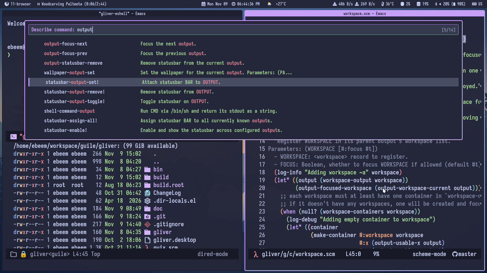
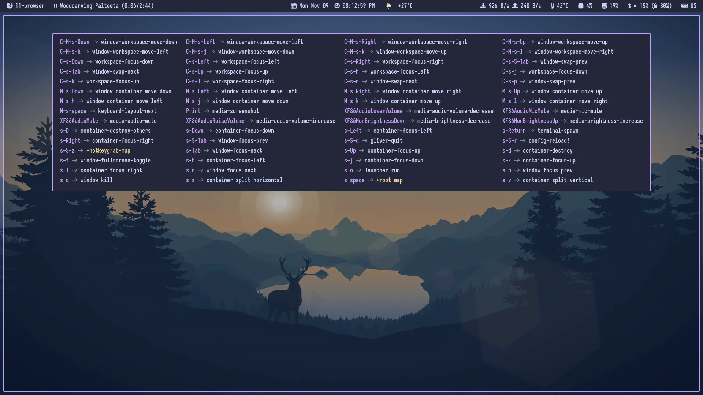

#+TITLE: The Gliver Window Manager
#+STARTUP: inlineimages

* The Gliver Window Manager

~Gliver~ brings the keyboard-driven, manual-tiling workflow of ~StumpWM~ to ~Wayland~, using ~River~ as the compositor backend and ~GNU Guile Scheme~ as the extension language. It attempts to be highly customizable while relying entirely on the keyboard for input.

#+ATTR_ORG: :width 900

** Status

~Gliver~ is considered almost complete feature-wise, it's possible to use it as a window manager if you are willing to tolerate some crashes and bugs. Please submit all the issues you face so we can make ~Gliver~ more stable.

I have ~Gliver~ installed which allows me to select it as the window manager from my display manager, but once I am in, I open a terminal on my ~Gliver~ source code and use the below command.

#+BEGIN_SRC sh
while true; do (killall -q gliver || true) && make run || sleep 3; done
#+END_SRC

The above will keep running =make run= on the source so if ~Gliver~ crashes, it will simply be executed again. This way you don't lose your wayland session (~Gliver~ state like how windows are arranged is lost). You can also simply kill the ~Gliver~ process if you make changes to the code and want them to take effect immediately.

You can find ~Gliver~'s logs in =${XDG_STATE_HOME}/gliver/gliver.log= (=~/.local/state/gliver/gliver.log= by default).
You may also connect the ~REPL~ via socket if you use a tool like ~Emacs Geiser~ via =geiser-connect-local=. The socket path is =${XDG_STATE_HOME}/gliver/repl.sock= (=~/.local/state/gliver/repl.sock= by default)

** Philosophy

~Gliver~ is heavily inspired by ~Emacs~ and ~StumpWM~, tailored specifically for the modern Wayland stack. This project aims to be "The Emacs of Wayland WMs."

*** Gliver is:

- Hackable and can be customized and enhanced in ~Guile Scheme~ utilizing a ~REPL~ in real-time

- Configured using the exact same language it is written in (configuration is code, rather than a static configuration file). You can start by simply configuring it and later implement new features.

- Free of a single enforced layout; you can use manual, alternating, scrolling, or any other layout you write yourself.

*** Gliver is not:

- A standalone Wayland compositor; it runs alongside River as a client and delegates all rendering and hardware duties.

- A drop-in replacement for any other window manager, even though you may find built-in configurations that can replicate most of the features found in other window managers.

** Architecture

~Gliver~ runs alongside ~River~ as the window manager client.

Because ~River~ relies on a non-monolithic architecture, it separates the compositor from the layout manager. ~River~ handles all compositor duties (rendering, input devices, GPU, Wayland protocol). ~Gliver~ communicates with ~River~ via Wayland protocols (such as =river-window-management-v1=) to determine window placement, focus, borders, keybindings, and all window management policy.

** Build & Start Gliver

*** Prerequisites

- GNU Guile (3.0+)
- River (v0.4+)
- libwayland
- libxkbcommon
- librsvg
- Guile-Cairo
- Pango
- GNU Make
- pkgconf

Optional dependencies (recommended for starters)
- foot (default terminal)
  Can be configured via =*terminal*= variable.
- iosevka font (default font)
  Can be configured via =*theme-font*= variable.
Note: It's highly recommended to use a nerd font (e.g. Iosevka Nerd Font). The statusbar in ~Gliver~ uses many icons that will otherwise won't be properly rendered.

**** Guix
Use ~guix.scm~ via =guix shell=

**** Arch Linux
#+BEGIN_SRC sh
sudo pacman -S --needed guile river wayland wayland-protocols libxkbcommon librsvg pango make pkgconf
sudo make install
#+END_SRC

Note: guile-cairo is only available in AUR, either build it yourself or use an AUR helper to install it
#+BEGIN_SRC sh
yay -S guile-cairo
# paru -S guile-cairo
#+END_SRC

*** Building

Building Gliver from source is straightforward:

#+BEGIN_SRC sh
make
sudo make install
#+END_SRC

*** Configuring
~Gliver~'s configuration is by default located in =~/.config/gliver/init.scm=. To get started, you may want to copy the sample configuration in =doc/examples/init.scm= into your configuration file. From ~gliver~'s source code, you may execute the below:
#+BEGIN_SRC sh
mkdir -p ~/.config/gliver && cp -n doc/examples/init.scm ~/.config/gliver/init.scm
#+END_SRC

*** Starting

Because ~gliver~ depends on ~river~, the cleanest way to run them is by passing the -c flag which ensures ~river~ initializes first and immediately runs ~gliver~ as its init executable (you must install ~gliver~ via =sudo make install= for this to work).

#+BEGIN_SRC sh
river -c gliver
#+END_SRC

Note: ~make install~ installs a Wayland session file (=gliver.desktop=) into =$(SESSIONDIR)= (by default =$(PREFIX)/share/wayland-sessions=), you can use your favorite display manager to run ~gliver~ and you should see it listed along with other window managers/candidates available on your system.

*** Running

You can run Gliver directly from source without installing it on your system, which is ideal for rapid development and testing. Ensure that ~River~ is running first, then execute:

#+BEGIN_SRC sh
make && make run
#+END_SRC

*Note:* If you are running ~River~ in a nested session (which is useful for debugging), you must set the correct ~WAYLAND_DISPLAY~ environment variable before starting ~Gliver~:

#+BEGIN_SRC sh
export WAYLAND_DISPLAY=wayland-1
make && make run
#+END_SRC

Note: exporting =WAYLAND_DISPLAY= allows you to also run ~Gliver~ from another display like ~tty~ in case ~Gliver~ crashes and your keybindings are lost.

** Default Keybindings

~Gliver~ provides a ~super~ key driven keybindings via ~(gliver contrib keybindings gliver)~ which is the keybindings used in the default configuration file provided. ~Gliver~'s keybindings use ~Emacs~ style to describe keybindings.

- =s-= ~Super~ / ~Windows~ key
- =S-= ~Shift~ key
- =C-= ~Control~ key
- =M-= ~Meta~ / ~Alt~ key

For example: =s-C-q= is equivalent to pressing =super+control+q=
You can always view the current configured =*top-map*= keybindings via =s-SPC h ?= (=super+space= followed by =h= followed by =?=).

#+ATTR_ORG: :width 900

~Gliver~ encourages discovery, so you better use the available built-in features to discover and recall features/keybindings.

For your reference, you can view [[file:../doc/keybindings.org][detailed keybindings documentation here]] (if you prefer documentation over built-in discovery tools).

** Contributing

Pull requests are always welcome! Here are some guidelines to ensure your contribution gets merged:

- Document your work: Preserve comments and docstrings explaining what the code does, and update them if your patch changes.
- Target the right directory: Most new features, modules, and packages should go into the ~contrib~ directory.
- Avoid change in ~core~: Contributions to the ~core~ directory will go through a lengthy review process, I prefer not to break existing APIs.
- Avoid AI-generated code: To ensure strict compliance with Codeberg's Terms of Use, please refrain from submitting code written by Large Language Models (LLMs).

** Wishlist

Here's a wishlist of features for the ~Gliver~ project:
- Implementing animations driven by Guile timers over the =set_dimensions= Wayland request.
- Implementing automated testing (most likely needs simulating river).
- Add guard checks whenever needed, some clients will violate the defined protocol and send null-pointers or invalid parameters which always needs to be checked to avoid crashes.

** Known Issues
*** Some clients will propose their own sizes and not respect the tiling system.
This was observed so far in ~vlc~ where it will resize itself based on video resolution. While it's possible to disable this behavior from ~vlc~ itself, I am looking for a solution that will work on all clients.
Note: this issue doesn't seem to be easy to resolve, clients in this case violate the wayland protocol and it doesn't seem to me that there is a way to stop them from doing so.

*** Some clients include their own decorations
This was observered so far in ~Emacs~ and ~librewolf~ where they will include a titlebar, I believe all ~gtk~ applications will do so. While it's possible to have a workaround from ~gtk~ css, I again want to have a solution that will work on other clients as well.
Note: this issue doesn't seem to be easy to resolve, clients in this case violate the wayland protocol and it doesn't seem to me that there is a way to stop them from doing so.

** GUI Components & Daemons

| Name                 | Gliver Component            | Good Alternatives |
|----------------------+-----------------------------+-------------------|
| output configuration | core/output.scm             | kanashi           |
| input configuration  | core/keybinding.scm         | channel, kwim     |
| topbar / statusbar   | gleui/statusbar.scm         | waybar, swaybar   |
| screen locker        | TODO                        | swaylock, waylock |
| idle management      | TODO                        | swayidle          |
| screen capture       | not planned                 | flameshot, grim   |
| application launcher | gleui/launcher.scm          | fuzzel, rofi      |
| notification daemon  | gleui/notifications.scm     | mako, dunst       |
| wallpaper manager    | river/wallpaper-manager.scm | swaybg, awww      |

** Help

As in ~Emacs~ and ~StumpWM~, you can always get documentation natively through ~Gliver~:

| Key       | Help                     |
|-----------+--------------------------|
| =s-SPC h v= | Variables                |
| =s-SPC h f= | Functions                |
| =s-SPC h k= | Key sequences            |
| =s-SPC h ?= | Show top map keybidnings |

You can also drop into the Live REPL at any time to inspect state.
