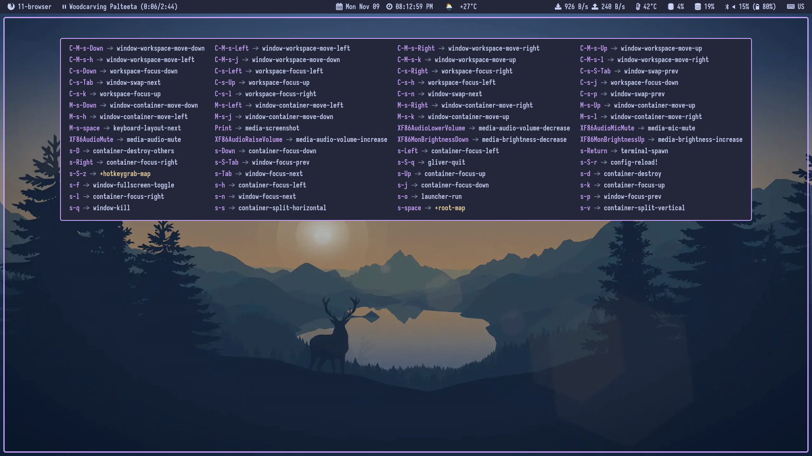

#+TITLE: The Gliver Keybindings
#+STARTUP: inlineimages

* Keybindings

~Gliver~ provides a ~super~ key driven keybindings . ~Gliver~'s keybindings use ~Emacs~ style to describe keybindings.

- =s-= ~Super~ / ~Windows~ key
- =S-= ~Shift~ key
- =C-= ~Control~ key
- =M-= ~Meta~ / ~Alt~ key

For example: =s-C-q= is equivalent to pressing =super+control+q=
You can always view the current configured =*top-map*= keybindings via =s-SPC h ?= (=super+space= followed by =h= followed by =?=).

** Gliver Keybindings (Default)

*** Basic Operations

| Key Combination | Command                  | Description                            |
|-----------------+--------------------------+----------------------------------------|
| =s-Return=        | =terminal-spawn=           | Spawn terminal emulator                |
| =s-q=             | =window-kill=              | Close/kill focused window              |
| =s-o=             | =launcher-run=             | Open application via launcher launcher |
| =s-f=             | =window-fullscreen-toggle= | Toggle fullscreen for focused window   |
| =s-S-r=           | =config-reload!=           | Reload configuration                   |
| =s-S-q=           | =gliver-quit=              | Quit Gliver session                    |

*** Focus Navigation

| Key Combination  | Command               | Description                                            |
|------------------+-----------------------+--------------------------------------------------------|
| =s-h=, =s-Left=      | =container-focus-left=  | Focus container to the left                            |
| =s-j=, =s-Down=      | =container-focus-down=  | Focus container below                                  |
| =s-k=, =s-Up=        | =container-focus-up=    | Focus container above                                  |
| =s-l=, =s-Right=     | =container-focus-right= | Focus container to the right                           |
| =s-n=, =s-Tab=       | =window-focus-next=     | Focus next window in container stack                   |
| =s-p=, =s-S-Tab=     | =window-focus-prev=     | Focus previous window in container stack               |
| =s-C-n=, =s-C-Tab=   | =window-swap-next=      | Swap current window with next window in container      |
| =s-C-p=, =s-C-S-Tab= | =window-swap-prev=      | Swap current window with  previous window in container |

*** Moving Windows Between Containers

| Key Combination  | Command                     | Description                               |
|------------------+-----------------------------+-------------------------------------------|
| =s-M-h=, =s-M-Left=  | =window-container-move-left=  | Move focused window to container on left  |
| =s-M-j=, =s-M-Down=  | =window-container-move-down=  | Move focused window to container below    |
| =s-M-k=, =s-M-Up=    | =window-container-move-up=    | Move focused window to container above    |
| =s-M-l=, =s-M-Right= | =window-container-move-right= | Move focused window to container on right |

*** Workspace Focus Navigation

| Key Combination  | Command               | Description                  |
|------------------+-----------------------+------------------------------|
| =s-C-h=, =s-C-Left=  | =workspace-focus-left=  | Focus workspace to the left  |
| =s-C-j=, =s-C-Down=  | =workspace-focus-down=  | Focus workspace below        |
| =s-C-k=, =s-C-Up=    | =workspace-focus-up=    | Focus workspace above        |
| =s-C-l=, =s-C-Right= | =workspace-focus-right= | Focus workspace to the right |

*** Moving Windows Across Workspaces

| Key Combination      | Command                     | Description                           |
|----------------------+-----------------------------+---------------------------------------|
| =s-C-M-h=, =s-C-M-Left=  | =window-workspace-move-left=  | Move window to workspace on the left  |
| =s-C-M-j=, =s-C-M-Down=  | =window-workspace-move-down=  | Move window to workspace below        |
| =s-C-M-k=, =s-C-M-Up=    | =window-workspace-move-up=    | Move window to workspace above        |
| =s-C-M-l=, =s-C-M-Right= | =window-workspace-move-right= | Move window to workspace on the right |

*** Container Layout

| Key Combination | Command                    | Description                               |
|-----------------+----------------------------+-------------------------------------------|
| =s-s=             | =container-split-horizontal= | Split container horizontally              |
| =s-v=             | =container-split-vertical=   | Split container vertically                |
| =s-d=             | =container-destroy=          | Destroy active container slot             |
| =s-D=             | =container-destroy-others=   | Destroy all other containers in workspace |

*** Media & Hardware Controls

| Key Combination       | Command                     | Description                |
|-----------------------+-----------------------------+----------------------------|
| =XF86AudioMute=         | =media-audio-mute=            | Toggle audio mute          |
| =XF86AudioLowerVolume=  | =media-audio-volume-decrease= | Lower audio volume         |
| =XF86AudioRaiseVolume=  | =media-audio-volume-increase= | Raise audio volume         |
| =XF86AudioMicMute=      | =media-mic-mute=              | Toggle microphone mute     |
| =XF86MonBrightnessDown= | =media-brightness-decrease=   | Decrease screen brightness |
| =XF86MonBrightnessUp=   | =media-brightness-increase=   | Increase screen brightness |
| =Print=                 | =media-screenshot=            | Take screenshot            |
